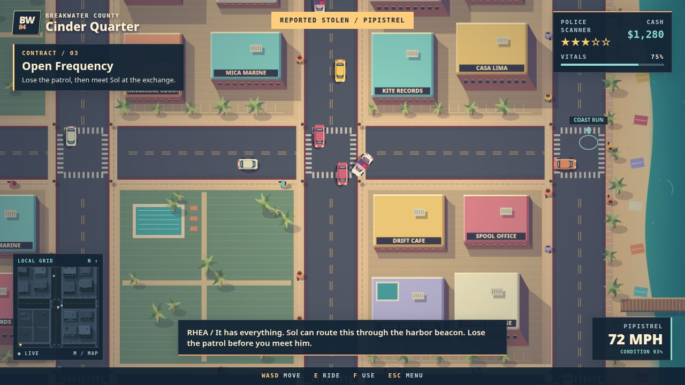

# Breakwater ’84

[](https://make.fun/c/gta6-01)
[](https://make.fun/c/gta6-01)
[](https://make.fun/c/gta6-01)

In the summer of 1984, the Breakwater Port Authority cuts the transmitter at Kite FM. Drive the coast as Ari, take back the station, and find out what the port board paid to keep off the air.



Open `game/index.html` in desktop Chrome, or serve `game/` from any static server. The game needs no build, account, or internet connection. Browser storage is used for saves when available.

| Key | Action |
| --- | --- |
| WASD or arrows | Walk, accelerate, reverse, and steer |
| Shift | Run on foot |
| E | Enter, take, or exit the nearest car |
| F | Interact at a marked location |
| Mouse and click | Aim and fire on foot |
| Space | Handbrake while driving; fire on foot |
| R | Reload |
| M | Toggle the city map |
| Q | Toggle Kite FM |
| Esc | Pause, save, or load |

The four story contracts take you from Marigold Coast to Cinder Depot and out to the harbor beacon. Between jobs, recover six lost masters, run the coast circuit, sell stolen cars at Mica Salvage, or tune your ride at Kite Garage.

To package the entry with Node 22 or newer:

```sh
MAKEFUN_OUTPUT_DIR=/tmp/gta6-01-out node main.ts
```

Source, procedural artwork, and synthesized audio are original. See [LICENSE](LICENSE).

---

Built for [make.fun](https://make.fun/?ref=vfk2n47z).
